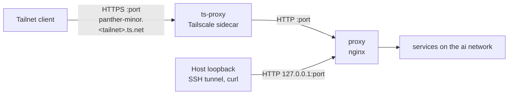

# 🔌 Networking & Security

> AI and monitoring services are reachable only through one Tailscale node, `panther-minor`, and on the host's loopback —
> never from the LAN or the public internet. The `ts-proxy` sidecar is that node: it terminates TLS with its Tailscale
> certificate and forwards each port to nginx, which listens on plain HTTP and is published on `127.0.0.1` only. No
> domain, certificate or firewall rule is involved.

**Related:** [Installation](installation.md) · [Architecture](architecture.md) · [Operations](operations.md)

---

## 🔐 Security model



| Layer      | Behavior                                                                                                                   |
| ---------- | -------------------------------------------------------------------------------------------------------------------------- |
| `ts-proxy` | The only tailnet entry point: node `panther-minor`, `tag:panther-minor`; HTTPS on the ports in its serve config, no others |
| `proxy`    | nginx on plain HTTP, one listener per port; published on `127.0.0.1` only                                                  |
| Docker     | Every other service uses `expose:` and is reachable only inside the `ai` network                                           |
| Tailnet    | Who reaches `tag:panther-minor` on which ports is the tailnet policy's decision                                            |
| UFW        | Allows only SSH (`2222`) on the host                                                                                       |
| SSH        | Port `2222`, key-only authentication, `AllowUsers` restricted; fail2ban bans brute-force attempts                          |

The sidecar runs `tailscaled` with kernel networking (`TS_USERSPACE=false`, `/dev/net/tun`, `NET_ADMIN`) inside its own
network namespace, so the tailnet interface exists only in that container. A tailnet packet can reach nothing but the
HTTPS listeners in the serve config; the host and the other containers have no tailnet address.

### Why loopback, not a firewall rule

Docker publishes ports with `nat/PREROUTING` DNAT, so packets reaching a container are _forwarded_, not delivered
locally — they never traverse the `INPUT` chain UFW manages, and `ufw deny 8000` cannot block a published port
([moby/moby#17496](https://github.com/moby/moby/issues/17496)). Publishing on `127.0.0.1` is enforced by the DNAT rule
itself, so the exposure does not exist in the first place. The sidecar needs no published port at all: it dials out
to the tailnet.

## 🌐 Port reference

### Public internet

| Port   | Service | Purpose                      |
| ------ | ------- | ---------------------------- |
| `2222` | SSH     | Hardened remote shell access |

### Tailnet (through `ts-proxy`)

HTTPS with the node's Tailscale certificate, each forwarded to the nginx listener of the same port.

| Port   | URL                                           | Upstream        | Role                                                  |
| ------ | --------------------------------------------- | --------------- | ----------------------------------------------------- |
| `8000` | `https://panther-minor.<tailnet>.ts.net:8000` | `llama-manager` | OpenAI-compatible LLM API with activity-aware routing |
| `8001` | `https://panther-minor.<tailnet>.ts.net:8001` | `sd-manager`    | OpenAI-compatible image generation API                |
| `8080` | `https://panther-minor.<tailnet>.ts.net:8080` | `open-webui`    | Browser UI for chat and image generation              |
| `3000` | `https://panther-minor.<tailnet>.ts.net:3000` | `grafana`       | Dashboards and visualization                          |
| `9090` | `https://panther-minor.<tailnet>.ts.net:9090` | `prometheus`    | Metrics scraping and storage                          |

`<tailnet>` is your tailnet DNS name; `tailscale status --json | jq -r .MagicDNSSuffix` on any tailnet device prints
`<tailnet>.ts.net`.

### Loopback (on the host)

`proxy` publishes the same five ports on `127.0.0.1` over plain HTTP: `http://localhost:8000` and so on. The CLI talks
to `llama-manager` this way.

### Internal only

Reachable solely inside the `ai` network: `llama-cpp` and `stable-diffusion-cpp` (`8000`), `amd-gpu-exporter`
(`5000`), `node-exporter` (`9100`), `llama-metrics-exporter` and `sd-metrics-exporter` (`9090`). The sidecar's health
endpoint listens on its own loopback (`127.0.0.1:9002`) for the Compose healthcheck.

## 🚪 Access patterns

### Via the tailnet (recommended)

```bash
curl https://panther-minor.<tailnet>.ts.net:8000/v1/models
open https://panther-minor.<tailnet>.ts.net:8080
```

The certificate is valid for `panther-minor.<tailnet>.ts.net`, so clients need no `--insecure` or trust-store changes.
Use the full name: the short `panther-minor` resolves through MagicDNS but does not match the certificate.

### Via SSH tunnel

For a single service when the client is not on the tailnet:

```bash
ssh -p 2222 -L 8080:localhost:8080 <user>@<server-ip>
open http://localhost:8080
```

### Directly on the host

```bash
curl http://localhost:8000/v1/models
```

## 🧾 Tailnet policy

The sidecar joins with a tagged auth key, so the policy must let you own `tag:panther-minor`, and — unless the policy
still allows all traffic — grant your devices its ports:

```jsonc
{
  "tagOwners": {
    "tag:panther-minor": ["autogroup:admin"]
  },
  "grants": [
    {
      "src": ["autogroup:member"],
      "dst": ["tag:panther-minor"],
      "ip": ["tcp:8000", "tcp:8001", "tcp:8080", "tcp:3000", "tcp:9090"]
    }
  ]
}
```

Narrow `src` to your own user or devices if the tailnet has other members. Tagged nodes have key expiry disabled, so
the node never needs re-authentication. Setup steps (MagicDNS, HTTPS certificates, auth key) are in
[Installation](installation.md#-prepare-the-tailnet).

## 🌍 Public services

None ship today. The sidecar is prepared for public services through [Funnel](https://tailscale.com/kb/1223/funnel),
under these rules:

| Rule                 | Detail                                                                                                                 |
| -------------------- | ---------------------------------------------------------------------------------------------------------------------- |
| Funnel ports         | Funnel accepts only `443`, `8443` and `10000`, so at most three public services                                        |
| One port per service | Each public service owns one Funnel port, so it gets its own host root (OAuth discovery needs `/.well-known/…` at `/`) |
| Own nginx listener   | Each public service gets its own nginx `server` on its Funnel port; private and public services never share a listener |
| `AllowFunnel`        | The serve config lists exactly the public ports under `AllowFunnel`; every other port stays tailnet-only               |
| Policy               | Funnel needs the `funnel` node attribute for `tag:panther-minor` in the tailnet policy                                 |
| Authentication       | Funnel traffic comes from the internet: the service authenticates every request itself                                 |

Adding one, e.g. a service `brain` on `8443`:

1. Grant Funnel to the node in the tailnet policy:

   ```jsonc
   {
     "nodeAttrs": [{ "target": ["tag:panther-minor"], "attr": ["funnel"] }]
   }
   ```

2. Add an nginx listener for it in `proxy/nginx.conf` (no published port needed: only the sidecar connects):

   ```nginx
   # brain (public, Funnel 8443)
   server {
     listen 8443;
     server_name _;

     location / {
       proxy_http_version 1.1;
       proxy_set_header Host $host;
       proxy_set_header X-Forwarded-For $proxy_add_x_forwarded_for;
       proxy_set_header X-Forwarded-Proto $forwarded_proto;
       proxy_pass http://brain:8000;
     }
   }
   ```

3. Merge the port, its handler and the `AllowFunnel` entry into the `ts-serve` config in `docker-compose.yml`
   (`$$` escapes `$` from Compose interpolation):

   ```json
   {
     "TCP": { "8443": { "HTTPS": true } },
     "Web": { "$${TS_CERT_DOMAIN}:8443": { "Handlers": { "/": { "Proxy": "http://proxy:8443" } } } },
     "AllowFunnel": { "$${TS_CERT_DOMAIN}:8443": true }
   }
   ```

4. Put the service on the `ai` network. One from another Compose project joins it as an external network named
   `panther-minor_ai`.
5. `cluster restart proxy ts-proxy`, then check `https://panther-minor.<tailnet>.ts.net:8443` from outside the tailnet.

## 🔁 Migrating from the domain setup

Installs from before the sidecar served every port with a Let's Encrypt certificate for an own domain (acme-dns,
`proxy certbot`, a renewal cron) and published nginx on the host's Tailscale address (`BIND_ADDR`). The steps below
move to the sidecar without downtime: the sidecar runs next to the old path until every client has switched.

1. **Prepare the tailnet** — MagicDNS, HTTPS certificates, `tag:panther-minor`, an auth key, and a host not named
   `panther-minor`; see [Installation](installation.md#-prepare-the-tailnet). Add the key to `.env` as `TS_AUTHKEY=…`.
   The host-name rule matters here: installs from before the sidecar often run on a host called `panther-minor`.
   Rename it first, and update SSH configs and anything else that reached it by that name.
2. **Start the sidecar on the current version.** nginx still serves TLS there, so the sidecar talks to it over
   `https+insecure`. Create `docker-compose.override.yml` (or add to it):

   ```yaml
   configs:
     ts-serve:
       content: |
         {
           "TCP": { "8000": {"HTTPS": true}, "8001": {"HTTPS": true}, "8080": {"HTTPS": true},
                    "3000": {"HTTPS": true}, "9090": {"HTTPS": true} },
           "Web": {
             "$${TS_CERT_DOMAIN}:8000": {"Handlers": {"/": {"Proxy": "https+insecure://proxy:8000"}}},
             "$${TS_CERT_DOMAIN}:8001": {"Handlers": {"/": {"Proxy": "https+insecure://proxy:8001"}}},
             "$${TS_CERT_DOMAIN}:8080": {"Handlers": {"/": {"Proxy": "https+insecure://proxy:8080"}}},
             "$${TS_CERT_DOMAIN}:3000": {"Handlers": {"/": {"Proxy": "https+insecure://proxy:3000"}}},
             "$${TS_CERT_DOMAIN}:9090": {"Handlers": {"/": {"Proxy": "https+insecure://proxy:9090"}}}
           }
         }

   volumes:
     ts-proxy-state:

   services:
     ts-proxy:
       container_name: ts-proxy
       image: tailscale/tailscale:v1.104.7
       restart: unless-stopped
       hostname: panther-minor
       environment:
         TS_AUTH_ONCE: 'true'
         TS_AUTHKEY: '${TS_AUTHKEY:-}'
         TS_EXTRA_ARGS: '--advertise-tags=tag:panther-minor'
         TS_SERVE_CONFIG: /config/serve.json
         TS_STATE_DIR: /var/lib/tailscale
         TS_USERSPACE: 'false'
       configs:
         - source: ts-serve
           target: /config/serve.json
       volumes:
         - 'ts-proxy-state:/var/lib/tailscale'
       devices:
         - '/dev/net/tun:/dev/net/tun'
       cap_add:
         - NET_ADMIN
       networks:
         - ai
       depends_on:
         - proxy
   ```

   Keep the service, volume and host names exactly as above: the new version defines the same ones, so the node
   identity carries over. Start it and check it from a tailnet device:

   ```bash
   ./bin/panther-minor cluster start ts-proxy
   curl https://panther-minor.<tailnet>.ts.net:8000/v1/models
   ```

3. **Switch the clients** to `https://panther-minor.<tailnet>.ts.net:<port>`: harness configs (the `harness-config` skill
   detects the old host and replaces it), Open WebUI and Grafana bookmarks, scripts.
4. **Update, then drop the old path.** Install the new version first:

   ```bash
   ./bin/panther-minor update
   ```

   Before the next Compose command, remove the `ts-proxy` service, the `ts-serve` config and the `ts-proxy-state`
   volume from `docker-compose.override.yml` (delete the file if nothing else is in it) — left in place, its
   `https+insecure` serve config overrides the new one and fails against plain-HTTP nginx. Remove the `BIND_ADDR=`
   line from `.env` too. Then apply it:

   ```bash
   ./bin/panther-minor cluster start
   ```

   `cluster start` recreates only the containers whose definition changed — `proxy` and `ts-proxy` — so clients see a
   seconds-long blip; the models stay loaded, the tailnet URLs stay the same and the volume keeps the node. If the
   update also spans other changes (build pins, managers, `preset.ini`), follow the usual
   [post-update](operations.md#-updating) `cluster build` and `cluster restart` instead, which restarts the whole
   stack.

5. **Clean up** what the new version no longer uses:

   ```bash
   crontab -l | grep -v 'proxy renew-ssl' | crontab -   # the renewal cron entry
   rm -rf proxy/ssl proxy/acme proxy/renew-ssl.log        # certificate material and its log
   sudo ufw delete allow 80/tcp
   sudo ufw delete allow 443/tcp
   ```

   At your DNS provider, delete the domain's `A` record and the `_acme-challenge` `CNAME`. The host's own Tailscale
   node is no longer needed for the services; keep it if you SSH over the tailnet.

## 🛠️ Where network behavior is defined

| File                 | Responsibility                                                                          |
| -------------------- | --------------------------------------------------------------------------------------- |
| `docker-compose.yml` | `ts-proxy` and its serve config (`ts-serve`), loopback-only ports of `proxy`            |
| `proxy/nginx.conf`   | Plain-HTTP listeners and upstream routing per port                                      |
| `.env`               | `TS_AUTHKEY` — the sidecar's first-login auth key                                       |
| Tailnet policy       | `tag:panther-minor` ownership, which devices reach which ports, `funnel` node attribute |
| `cli/**/*.sh`        | Firewall rules, SSH defaults, the `TS_AUTHKEY` reminder in `setup env`                  |

---

## ❓ FAQ

### Can other devices on my LAN reach the services?

No. nginx is published only on loopback and the sidecar listens only on the tailnet; LAN clients must join the tailnet
or use an SSH tunnel.

### Why can't I just `ufw deny` a port?

Because Docker's DNAT forwards published-port traffic around the `INPUT` chain, so UFW never sees it. Address-scoped
publishing (here: loopback only) is the reliable control.

### Who renews the certificate?

`tailscaled` in the sidecar, automatically. There is no cron and nothing in `proxy/`. Like every publicly trusted
certificate, it is recorded in Certificate Transparency logs, which makes the name `panther-minor.<tailnet>.ts.net`
public — not reachable, since only tailnet devices can connect.

### The services are unreachable from the tailnet but the stack runs. What now?

Check the sidecar: `./bin/panther-minor logs ts-proxy --tail 100` and `cluster status` (its healthcheck turns
unhealthy without a tailnet address). Loopback and SSH tunnels keep working meanwhile. A first start without
`TS_AUTHKEY` logs a login URL instead of joining.

### Are tailnet connections direct or relayed?

Check from a client with `tailscale ping panther-minor`: it should end with `via <ip>:<port>`, a direct path.
`via DERP(…)` means relayed traffic, which adds latency to every streamed token. The sidecar sits behind Docker's NAT
and UFW denies incoming traffic, so NAT traversal usually finds a direct path but is not guaranteed to. If it stays
relayed, give the sidecar a fixed WireGuard port and publish it — on a port other than the host node's `41641`:

```yaml
services:
  ts-proxy:
    environment:
      TS_TAILSCALED_EXTRA_ARGS: '--port=41642'
    ports:
      - '41642:41642/udp'
```

in `docker-compose.override.yml`, then `./bin/panther-minor cluster start`. The port is open to the internet like any
Tailscale node's, which is safe: WireGuard drops every packet that is not from an authenticated peer.

### The node came back as `panther-minor-1`. Why?

Either the `ts-proxy-state` volume was deleted (`cluster cleanup` removes all named volumes), so the sidecar logged in
as a new node while the old `panther-minor` still existed, or another node — usually the host itself — holds the name.
Delete the stale nodes in the [admin console](https://login.tailscale.com/admin/machines) or rename the host (see
[Installation](installation.md#-prepare-the-tailnet)), make sure `TS_AUTHKEY` holds a valid key, then
`./bin/panther-minor cluster restart ts-proxy`.

### Do I still need Tailscale on the host itself?

Not for the services. `setup tailscale` still installs it for SSH over the tailnet; that node must not be named
`panther-minor`, or the sidecar becomes `panther-minor-1`.
